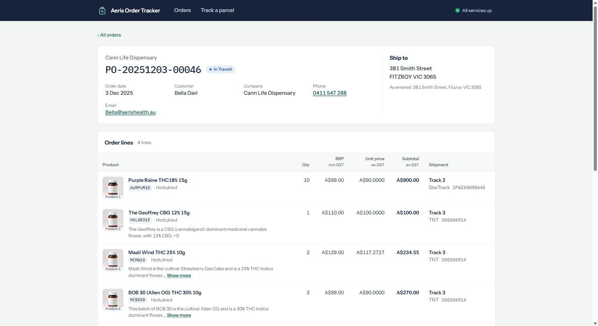
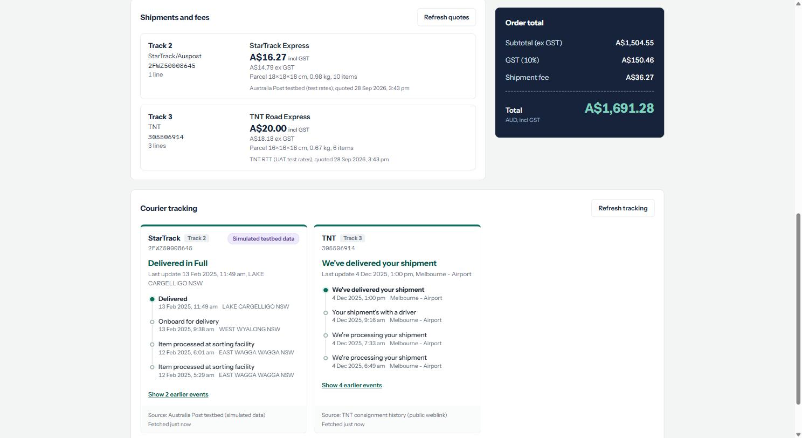

# Aeris Order Tracker — 订单详情、GST 计算、运费估算与物流跟踪

一个以澳大利亚业务场景为背景的全栈应用：读取订单与 SKU 数据，按澳洲 GST 规则计算每个订单的金额，
通过 StarTrack（澳邮）与 TNT 的真实接口获取运费报价和物流跟踪信息，并在 React 前端中展示。

- 后端：Python 3.12 · FastAPI（全异步）· SQLAlchemy 2（async）· Alembic · PostgreSQL 16 · Redis 7 · Gunicorn + Uvicorn workers
- 前端：React + Vite + TypeScript
- 部署：Docker Compose 一键启动（db / redis / backend / frontend）
- Python 依赖管理：uv





---

## 1. 快速开始（Docker，推荐）

```bash
cp .env.example .env
# 编辑 .env：填写 POSTGRES_PASSWORD，以及 AusPost / TNT 的测试凭证（见评估文档第 11 节）
docker compose up --build
```

| 地址 | 说明 |
|---|---|
| http://localhost:8080 | 前端界面 |
| http://localhost:8000/docs | 后端 API 文档（Swagger） |
| http://localhost:8000/api/health | 健康检查（数据库 / Redis / 各物流接口是否已配置） |

后端容器启动时会依次执行：`alembic upgrade head`（建表）→ `python -m app.seed`（导入 `data/` 下的数据）→ 启动 Gunicorn。
重复启动是安全的：导入脚本在一个事务内整体替换数据。

> 端口说明：本机若已安装 PostgreSQL（占用 5432），Docker 中的数据库映射到 **5433**，可在 `.env` 的 `POSTGRES_PORT` 修改。

## 2. 不使用 Docker 的本地开发

```bash
docker compose up -d db redis          # 只启动数据库和 Redis

cd backend
uv sync
uv run --env-file ../.env alembic upgrade head
uv run --env-file ../.env python -m app.seed
uv run --env-file ../.env uvicorn app.main:app --reload     # http://localhost:8000
uv run pytest                                                # 34 个离线测试

cd ../frontend
npm install
npm run dev                                                  # http://localhost:5173，/api 代理到 8000
```

- **Windows 注意**：psycopg 的异步模式不支持 Windows 默认的 `ProactorEventLoop`。
  `uvicorn --reload` 会在子进程中使用兼容的事件循环，因此本地请务必带 `--reload`；`app/seed.py` 已自行处理。Docker（Linux）不受影响。
- Gunicorn 不支持 Windows，仅在容器内使用。
- 前端 `VITE_USE_MOCKS=true` 时使用内置模拟数据（无需后端），`false` 时调用真实 API。

## 3. 项目结构与架构

```
├── docker-compose.yml        db / redis / backend / frontend
├── .env.example              所有配置项（只有变量名，不含凭证）
├── data/
│   ├── orders.json           订单、订单行、物流单号（与评估文档中的三张表结构一致）
│   └── sku_data.json         从 SQL 查询网站导出的 SKU 数据（原样保存）
├── backend/
│   ├── Dockerfile · gunicorn.conf.py · entrypoint.sh · pyproject.toml · uv.lock
│   ├── alembic/              数据库迁移
│   ├── app/
│   │   ├── main.py           FastAPI 应用；lifespan 中创建共享的 HTTP 客户端、物流客户端、Redis 缓存
│   │   ├── config.py         从环境变量读取全部配置
│   │   ├── db.py             异步引擎（psycopg 3 async）
│   │   ├── models/           products / orders / order_lines / shipments / shipping_quotes
│   │   ├── parsing/          输入清洗：日期、地址、单位、数量、SKU
│   │   ├── schemas/          API 响应模型（金额以字符串传输）
│   │   ├── services/
│   │   │   ├── pricing/      GST 与金额计算（纯函数，Decimal）
│   │   │   ├── couriers/     auspost.py（StarTrack 跟踪 + 报价）、tnt.py（TNT 跟踪 + RTT 报价）
│   │   │   ├── shipping/     装箱模型与按订单汇总运费（结果存入 PostgreSQL）
│   │   │   ├── tracking/     跟踪查询 + Redis 缓存
│   │   │   └── orders.py     组装订单详情
│   │   ├── api/              orders / tracking / health 路由
│   │   └── seed.py           数据导入与校验
│   └── tests/                解析、计算、装箱、物流接口（httpx MockTransport，离线）
└── frontend/                 React + Vite + TS；nginx 提供静态文件并把 /api 反向代理到后端
```

**请求流程（订单详情页）**

1. `GET /api/orders/{no}`：读取订单 → 计算每行金额 → 读取已保存的运费报价（首次访问时并发向各物流公司询价并保存）→ 汇总。
2. 页面渲染后，前端再单独请求 `GET /api/orders/{no}/tracking`，因此物流接口慢或失败都不会阻塞订单页面。
3. 跟踪查询先读 Redis；未命中时 **StarTrack 与 TNT 并发请求**，成功结果写入 Redis（TTL 10 分钟）。

**为什么这样设计**

- **全异步**：一个页面需要调用多个外部接口（StarTrack 跟踪、TNT 跟踪、两家报价）。使用 `httpx.AsyncClient` + `asyncio.gather` 并发执行，
  实测同样的 4 个物流请求：并发 4.1 秒 vs 顺序 13.2 秒。数据库同样使用异步驱动，避免阻塞事件循环。
- **PostgreSQL 存运费报价**：运费是订单金额的一部分，需要可追溯（保存了装箱尺寸、重量、服务、来源和时间）。
- **Redis 存跟踪结果**：跟踪数据时效短，且 AusPost 限制每分钟 10 次请求；Redis 原生支持过期时间。
  Redis 不可用时应用照常工作（直接请求物流公司），并在 30 秒内跳过 Redis，避免每次请求都等待连接超时。
- **Gunicorn + UvicornWorker**：Gunicorn 管理多进程，每个 worker 运行异步应用。迁移和数据导入在 Gunicorn 启动前只执行一次。

## 4. 输入数据结构

`data/orders.json` 与评估文档中的三张表一一对应，可以直接替换为真实订单：

```jsonc
{
  "orders": [
    { "order_no": "PO-20251130-00072", "order_date": "30/11/25", "status": "Completed",
      "company": "V22 Dispensary", "customer_name": "Jason Hu", "phone": "0481 735 488",
      "email": "Jason@aerishealth.au", "address": "125 Toorak Road, South Yarra VIC 3141" }
  ],
  "order_lines": [
    { "sku": "TBAMET10", "quantity": 3, "assigned_tracking": "Track 1", "order_no": "PO-20251130-00072" }
  ],
  "tracking": [
    { "assigned_tracking": "Track 1", "tracking_no": "2FWZ50008569", "logistics_company": "StarTrack/Auspost" }
  ]
}
```

- `order_date`：DD/MM/YY（澳洲格式，日在前）。
- `address`：`<街道>, <区> <州> <邮编>`，用于提取运费报价所需的区名和邮编。
- `logistics_company`：包含 “StarTrack/AusPost” → StarTrack；包含 “TNT” → TNT；其他 → 显示“未实现”。
- `data/sku_data.json`：SQL 查询网站返回的 JSON 原样保存（`rows` 数组）。查询语句见第 8 节。

导入规则（`app/seed.py`）：

| 情况 | 处理 |
|---|---|
| SKU 不存在、数量无效（0、负数、小数、`"two"`）、跟踪编号未知 | 保留该行并标记，前端显示原因，不计入金额 |
| 订单行引用了不存在的订单、订单日期无法解析 | 跳过并记录警告 |
| 地址无法解析 | 保留订单，运费报价显示“地址无法识别” |
| SKU 大小写/空格不一致（如 `" tbamet10 "`） | 统一为 `TBAMET10` 后匹配 |

## 5. 金额计算规则

评估文档确认：**RRP 即 SKU 单价，已含 GST**。

| 项目 | 公式 |
|---|---|
| 不含 GST 单价 | RRP ÷ 1.10 |
| 行小计（不含 GST） | RRP × 数量 ÷ 1.10，四舍五入到分 |
| 订单小计（不含 GST） | 各行小计之和 |
| GST | 订单小计 × 10%，四舍五入到分 |
| 订单总额 | 小计 + GST + 运费 |

**舍入处理（发现的难点）**：÷1.10 会产生无限小数，舍入位置不同结果会差几分钱。本项目的做法：

- 行小计由未舍入的值计算后再舍入到分，因此页面上各行小计**精确相加等于订单小计**。
- 不含 GST 单价显示 **4 位小数**（例：149 ÷ 1.10 = 135.4545），这样“单价 × 数量”与行小计在页面上能对上（135.4545 × 4 = 541.818 → 541.82）。
  若单价只显示 2 位（135.45 × 4 = 541.80），与 541.82 不一致，容易被误认为计算错误。
- 因为每行单独舍入，订单总额（不含运费）可能与 RRP 合计相差 1 分（订单 1：2,131.01 vs RRP 合计 2,131.00）。

计算结果（运费见第 6 节）：

| 订单 | 小计（不含 GST） | GST | 运费 | 总额 |
|---|---|---|---|---|
| PO-20251130-00072 | 1,937.28 | 193.73 | 16.27 | 2,147.28 |
| PO-20251203-00046 | 1,504.55 | 150.46 | 36.27 | 1,691.28 |

所有金额使用 `Decimal`，API 以字符串传输（如 `"1937.28"`），前端只负责格式化，不做浮点运算。

## 6. 运费估算（加分项，已实现）

使用两家物流公司的**真实报价接口**，而不是自定的公式：

- **StarTrack**：AusPost Shipping API `POST /prices/shipments`，产品 `EXP`（StarTrack Express），返回含税与不含税价格。
- **TNT**：Rated Transit Times（RTT）XML 接口（UAT 测试环境），服务 `76`（Road Express）；若该服务不可用则取最便宜的服务并注明。

**运费按订单计算**：同一订单中、使用同一个跟踪号的所有有效行视为一个包裹，每个（订单, 包裹）询价一次，订单运费 = 各包裹报价之和。
不同收件人的订单从不合并。订单 2 分两个包裹（StarTrack 16.27 + TNT 20.00 = 36.27）。

**装箱假设**（可在 `.env` 中调整）：

- 包裹体积 = Σ(商品体积 × 数量) × 1.25（`PACKING_FACTOR`，填充物空间）；商品体积优先用 `volume` 字段，缺失时用 长 × 宽 × 高。
- 包裹形状按同体积立方体计算，边长向上取整到厘米。
- 包裹重量 = Σ(商品重量 × 数量) + 0.3 kg（`PACKAGING_WEIGHT_KG`，纸箱）。
- SKU 数据中的 `Volumetric_GrossWeight` 与实际尺寸不一致（例如 76×76×78 mm 的商品标注 0.02 kg），因此未使用，由物流公司按尺寸自行计算体积重。
- 数量无效或 SKU 不存在的行不装箱。

**GST 处理**：订单中的 “Shipment Fee” 使用**含 GST** 的运费（客户实际支付的金额）。StarTrack 直接返回含税价；
TNT RTT 返回的价格按不含 GST 处理并加 10%（`TNT_PRICE_INCLUDES_GST=false`，接口未说明，属于假设）。
按评估文档，GST 一行只针对商品小计计算。

**失败处理**：报价失败时运费记为 **A$0.00** 并在页面显示原因（例如接口不可用、地址错误），订单照常显示。
报价结果保存在 PostgreSQL，页面上的 “Refresh quotes” 可重新询价。

## 7. 物流跟踪

| 物流公司 | 接口 | 说明 |
|---|---|---|
| StarTrack / AusPost | `GET /track?tracking_ids=...`（Basic 认证 + `Account-Number` 头，使用 StarTrack 账号） | 每次最多 10 个单号，并发受限（最多 3 个请求同时进行）以遵守每分钟 10 次的限制 |
| TNT | 公开的 consignment history 页面 `CnmHxAS.asp?<单号>`，解析 HTML 表格 | TNT 澳洲没有可用的 JSON/XML 跟踪接口；该页面无需认证 |

页面显示：当前状态、最后更新时间与地点、完整事件时间线（最新在前）、数据来源、是否来自缓存。

每种失败都有明确的状态，前端分别显示，不会导致页面崩溃：

| 状态 | 含义 | 例子 |
|---|---|---|
| `ok` | 获取成功 | — |
| `not_found` | 物流公司不认识该单号 / 单号格式无效 | `BAD#CONNOTE`（测试订单中故意设置） |
| `unavailable` | 接口无法访问或返回错误（附错误码） | 401 认证失败、429 超过频率限制、超时 |
| `not_implemented` | 没有该物流公司的集成 | 未知物流公司 |

评估文档提供的额外测试单号（`RBXZ50016112`、`2FWZ50020500`、`2FWZ50020498`、`2FWZ50020475`）可在前端 “Tracking lookup” 页面查询。

## 8. 发现的难点及处理方式

1. **SQL 查询网站的示例有误导性**：示例使用 `FROM sku` 和 `sku_code`，实际表名是 `product_list`、列名是 `SKU`。
   用示例中的列名查询不会报错，而是**静默返回 0 行**。使用的查询：
   `SELECT * FROM product_list WHERE SKU IN ('TBAMET10','TBAMET28','TBOPAL28','AURPUR10','HARNIG','LELCBD100','HALGEO15','MCMW10','MCBO30');`
2. **SKU 数据是带单位的字符串**（`"76.0mm"`、`"68.0g"`、`"0.02kg"`、`"450528.0mm³"`、`"110.00"`），部分文本含多余换行/空格，
   描述字段有 `"."` 占位 → 编写解析函数统一转换为 mm / mm³ / g，并清理文本。
3. **舍入问题**（见第 5 节）。
4. **起始邮编错误**：文档写 “2111 (Ryde, NSW)”，但 2111 是 Gladesville，Ryde 是 2112。TNT 对 “RYDE/2111” 直接报错（规则 590）。
   因为物流公司同时校验区名和邮编，本项目使用 `GLADESVILLE 2111`（保持文档给出的邮编，可在 `.env` 修改）。
5. **第一份 PDF 中的 AusPost 凭证已过期**（全部返回 401），评估 HTML 中的“更新后凭证”可用。
6. **AusPost 测试环境的跟踪数据是模拟的**：任何单号（甚至随意编造的 `XXXX00000000`）都会返回相同的样例历史（2025 年 2 月，Lake Cargelligo）。
   因此页面上对该来源标注 “Australia Post testbed (simulated data)”，不把它当作真实的包裹状态。
7. **一个无效单号会导致整批请求失败**：AusPost 在同一批次中遇到格式不符的单号时返回 400（错误 51103），其他有效单号也拿不到结果。
   处理：批量请求被拒绝时，自动改为逐个查询，只有无效单号失败。
8. **订单状态与物流状态矛盾**：订单 2 标记为 “In Transit”，但 TNT 显示该包裹已于 2025-12-04 送达。页面同时展示两者，不擅自修改订单状态。
9. **TNT RTT 请求需要“双重编码”**：XML 需先 URL 编码再作为表单字段提交，否则服务器返回 ASP.NET 错误页。
10. **Redis 不可用时的性能**：redis-py 默认会重试连接，Redis 停止时每次缓存访问约 2 秒。
    处理：关闭重试、0.5 秒超时，并在失败后 30 秒内跳过 Redis（简单熔断）。
11. **手写迁移与模型不一致**：`alembic check` 发现迁移中的索引未在模型中声明，已修正；之后的迁移使用 `--autogenerate`。

## 9. 假设

- **测试订单**：`PO-TEST-0001`、`PO-TEST-0002` 为自行生成的虚构订单（虚构客户与地址），用于演示：不存在的 SKU、数量为 0、数量为 `"two"`、
  SKU 大小写/空格不规范、无效的 TNT 单号、额外的 AusPost 测试单号。
- **产品图片**：未使用真实产品图片。使用 Canva AI 生成的**通用、无品牌**产品类型图片，按 SKU 数据中的 `DosageType` 选择：
  干燥草本（Herb, dried）→ 药罐、吸入剂（Inhalation）→ 吸入式药筒、口服液（Oral liquid）→ 滴管瓶。
  图片不代表真实包装。找不到 SKU 或类型未知时，显示通用药瓶图标，并标注 “Product 1”、“Product 2”……
- 运费与装箱相关假设见第 6 节；TNT 价格按不含 GST 处理。
- TNT 跟踪使用公开页面，未使用 “Secured Weblinking” 凭证（该页面无需认证，且不校验单号归属）。
- 时间：AusPost 返回带时区的 ISO 时间；TNT 页面没有时区，按当地时间显示。
- 起始地址：GLADESVILLE NSW 2111（见难点 4）。

## 10. 测试

```bash
cd backend && uv run pytest
```

34 个测试，全部离线运行（物流接口使用 `httpx.MockTransport` 与真实响应格式）：

- 解析：日期（日在前，拒绝美式日期）、地址、单位换算、数量校验、SKU 规范化
- 计算：订单 1 / 订单 2 的小计、GST、总额；4 位单价与行小计一致；各类无效行被排除并给出原因；GST 四舍五入
- 装箱：订单 2 TNT 包裹尺寸与重量；缺失尺寸/重量时的警告
- 物流：AusPost 事件合并与去重、单号级错误、批量被拒后逐个重试、401/超时不抛异常、报价解析；
  TNT HTML 解析、无效单号不发请求、RTT 双重编码、业务规则错误

另外已对真实接口做过端到端验证（StarTrack 跟踪与报价、TNT 跟踪与 RTT 报价）。

## 11. 安全

- 所有凭证只存在于本地 `.env`（已在 `.gitignore` 中排除）；仓库中只有 `.env.example`（仅变量名）。
- 评估文档 HTML 含明文凭证，同样被 `.gitignore` 排除。
- 凭证只在后端使用，不会出现在前端代码或 API 响应中；日志只记录错误类型和错误码，不记录请求头或表单内容。
- 后端容器以非 root 用户运行。

## 12. 可改进之处

- 使用 Celery / 定时任务定期刷新“运输中”包裹的跟踪信息，使页面始终命中缓存。
- 支持从 CSV / Excel 导入订单。
- AusPost 生产环境凭证可返回真实跟踪数据（测试环境为模拟数据）。
